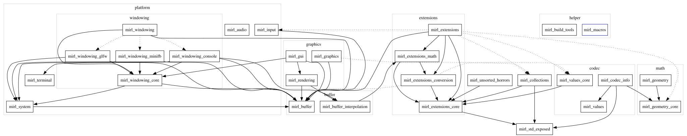
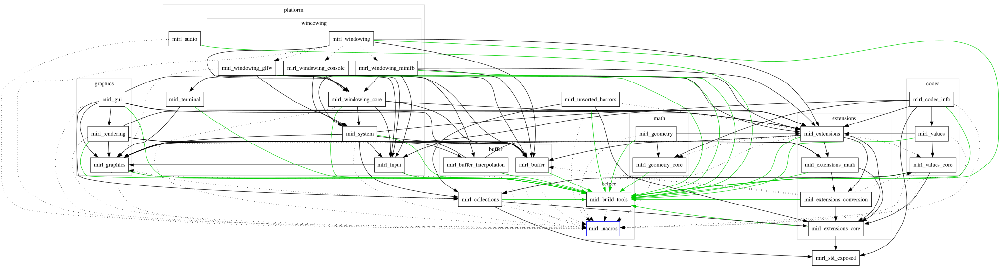

# **[Mirl](https://github.com/Miner3D-Gamer/mirl)**

### A mini ecosystem of crates that all follow the [Mirl Guidelines](.workspace/markdown/docs/guidelines.md) and try to work well with one another.

> Disclaimer:
>
> 1.  This mini ecosystem is still a WIP due to the recent split/reorganization.
> 2.  Most of these libs require nightly to access the `feature` keyword (for faster runtime execution, `no_std` support, and better customizability.)

The crates contained here vary in purpose so it is better to better to inspect their descriptions individually [here](.workspace/markdown/docs/crates.md#these-aspects-are-now-offered-in-specialized-packages)

## [Crate Categories](.workspace/markdown/docs/crates.md):

- [Extensions](.workspace/markdown/docs/crates.md#extensions)
- [Widowing](.workspace/markdown/docs/crates.md#windowing)
- [Codec](.workspace/markdown/docs/crates.md#codec)
- [Other](.workspace/markdown/docs/crates.md#other)
- [Deprecated](.workspace/markdown/docs/crates.md#deprecated)

## [Supported External Crates](.workspace/markdown/docs/supported_crates.md)

- [Currently Supported](.workspace/markdown/docs/supported_crates.md#supported-crates)
- [May be Supported in the future](.workspace/markdown/docs/supported_crates.md#may-see-support-in-the-future)

## [TODO](.workspace/markdown/docs/todo.md)

- [Helper Scripts](.workspace/markdown/docs/todo.md#helper-scripts)
- [Crates](.workspace/markdown/docs/todo.md#crates)
- [Testing](.workspace/markdown/docs/todo.md#testing)
- [Other](.workspace/markdown/docs/todo.md#other)

## [Common Concerns](.workspace/markdown/docs/common_concerns_in_rust.md)

- [Nightly](.workspace/markdown/docs/common_concerns_in_rust.md#nightlyfeatures)
- [Unsafe](.workspace/markdown/docs/common_concerns_in_rust.md#unsafe)
- [Ai](.workspace/markdown/docs/common_concerns_in_rust.md#ai)
- [`no_std` support](.workspace/markdown/docs/common_concerns_in_rust.md#no_std-support)

---

Click here to view the mirl connection graph (No longer up to date)

The crates under mirl and their relation (simplified):

The crates under mirl and their relation (including compile time & proc macro dependencies):

